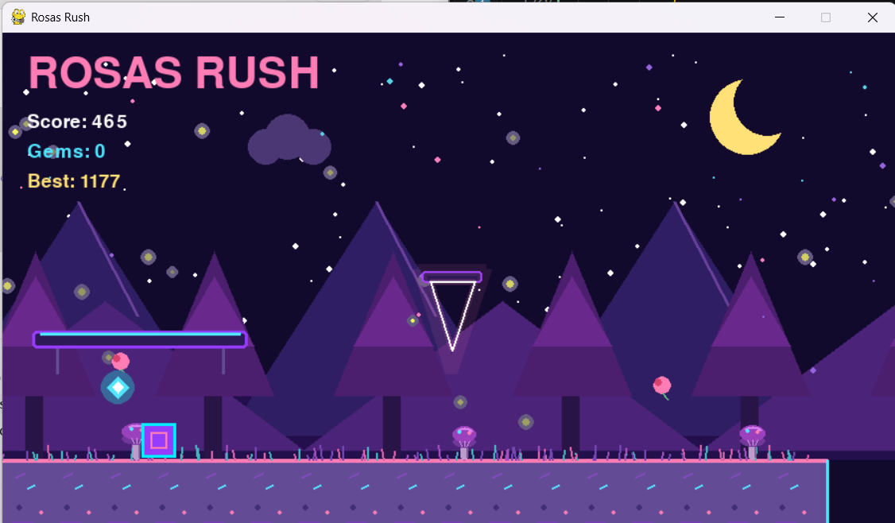

<<<<<<< HEAD
# Rosas Rush 

Rosas Rush is a 2D endless runner game I made using Python and Pygame. It is inspired by Geometry Dash, where players have to avoid obstacles, jump across gaps, and collect items while trying to get a high score. The name Rosas Rush also has a small personal meaning behind it, as it was inspired by someone I truly admire.

## Game Preview

## Features

- Jumping and landing mechanics
- Spikes, blocks, moving blocks, hanging spikes, and rotating saw blades
- Elevated platforms and ground gaps
- Jump orbs and jump pads
- Rose and gem collectibles
- Combo system
- Achievement system with progress tracking
- High score and increasing difficulty
- Animated background with mountains, trees, mushrooms, fireflies, and particles
- Jump, landing, and death effects

## Controls

- SPACE - Jump
- SPACE after Game Over - Restart
- Cursor/Mouse Cursor - Select and Click Buttons
- Mouse Wheel - Scroll

## How to Run

1. Install Python.
2. Install Pygame:

   pip install pygame

3. Download or clone this repository.
4. Open the project folder.
5. Run:

   'py main.py' (for week 2 version)
   'py rosasrush2.py' (for week 3 version)
   'py rosasrush3.py' (for week 4 version)

## Made With

- Python
- Pygame

## Game Development

WEEK 2 (main.py)
- created the game environment
- worked on player movement and jumping mechanics
- added three types of obstacles (spikes, blocks, double spike)
- added rose collectibles which adds to your score when collected
- added collision detection, scoring system, and i increased the game speed
- created a game over or restart feature so players can play again
- also added elevated platforms where players can jump or land onto
- introduced actual ground gaps as well to add a little difficulty in the game
- also added collectible gems worth extra points
- added a high score system that keeps the paler's best score even after restarting
- created decorative mushroom throughout the level
- redesigned the background with mountains, trees, clouds, stars, and animated environmental details

WEEK 3 (rosasrush2.py)
- added a glow effect to the spikes and changed their colors since the previous one blended too well with the mushrooms
- created rotating saw blades to add a new obstacle
- added moving blocks
- added hanging spikes
- introduced jump orbs and pads as additional ways to jump and navigate through the level
- added a combo system that rewards players for consecutive successful actions
- added achievement system to give players more goals to accomplish
- improved the collision detection
- added landing effects
- enhanced the death effects with better particle animations
- added jump trail particles
- added landing dust effects

WEEK 4 (rosasrush3.py)
- added a main menu that appears first when you open the game
- fixed the achievement sections since some texts overlap
- added moving sparkles on the menu section and made the background dim a little
- fixed the achievement system and made it store data even after closing the game
- added more variation of achievements so that players will strive for more (this includes: gem hoarder, rose keeper, combo master, first flight, and dedicated player)
- also created a statistics page where total gems collected, total attempts, best combo, highest sscore are displayed
- integrated a small personal records part where things like longest survival time and highest score in a single run are highlighted
- made the statistics page scrollable
- added a welcome screen that also asks the player's name before playing
- added a reset button that resets everything including all the progress made

## About the Project

This is my personal game development project for Hack Club's Terra. I'm still working on improving the gameplay, visuals, and adding more features as I learn more about Python and game development. I'm also a beginner so please bear with me :))
