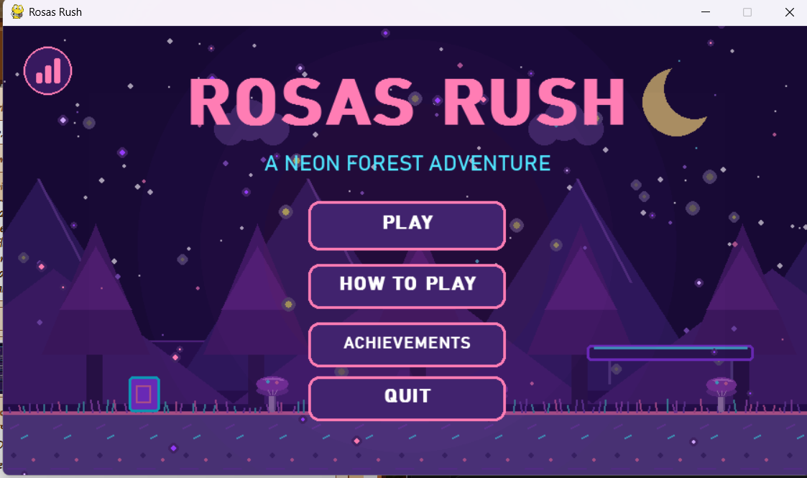

# Rosas Rush

Rosas Rush is a 2D endless runner game I made using Python and Pygame. It is inspired by Geometry Dash, where players have to avoid obstacles, jump across gaps, and collect items while trying to get a high score. The name Rosas Rush also has a small personal meaning behind it, as it was inspired by someone I truly admire.

## Game Preview

## Features

- Jumping and landing mechanics
- Spikes, blocks, moving blocks, hanging spikes, and rotating saw blades
- Elevated platforms and ground gaps
- Jump orbs and jump pads
- Rose and gem collectibles
- Combo system
- Achievement system with progress tracking
- High score and increasing difficulty
- Animated background with mountains, trees, mushrooms, fireflies, and particles
- Jump, landing, and death effects

## Controls

- SPACE - Jump
- SPACE after Game Over - Restart
- Mouse Cursor - Select and Click Buttons
- Mouse Wheel - Scroll

## How to Run

You can download and play Rosas Rush here:

For Week 3:
[Rosas Rush v1.1.0 - Download Demo](https://github.com/maryjamercalibot-max/rosasrush/releases/tag/v1.1.0)

1. Open the release link above.
2. Download RosasRush.exe from release assets.
3. Open the downloaded file to play.

For Week 4:
[Rosas Rush v.1.2.0 - Download Demo](https://github.com/maryjamercalibot-max/rosasrush/releases/tag/v1.2.0)

1. Open the release link above.
2. Download RosasRush-v1.2.0.exe from release assets.
3. Open the downloaded file to play.

You dont need to install python or pygame separately.

## Made With

- Python
- Pygame CE

## Game Development

### WEEK 2 (main.py)

- Created the game environment
- Worked on player movement and jumping mechanics
- Added three types of obstacles (spikes, blocks, double spikes)
- Added rose collectibles which add to your score when collected
- Added collision detection, scoring system, and increased the game speed
- Created a game over or restart feature so players can play again
- Added elevated platforms where players can jump or land
- Introduced actual ground gaps to add a little difficulty to the game
- Added collectible gems worth extra points
- Added a high score system that keeps the player's best score even after restarting
- Created decorative mushrooms throughout the level
- Redesigned the background with mountains, trees, clouds, stars, and animated environmental details

### WEEK 3 (rosasrush2.py)

- Added a glow effect to the spikes and changed their colors since the previous ones blended too well with the mushrooms
- Created rotating saw blades to add a new obstacle
- Added moving blocks
- Added hanging spikes
- Introduced jump orbs and pads as additional ways to jump and navigate through the level
- Added a combo system that rewards players for consecutive successful actions
- Added an achievement system to give players more goals to accomplish
- Improved collision detection
- Added landing effects
- Enhanced death effects with better particle animations
- Added jump trail particles
- Added landing dust effects

### WEEK 4 (rosasrush3.py)

- Added a main menu that appears first when you open the game
- Fixed the achievement sections since some texts overlapped
- Added moving sparkles on the menu section and made the background dim a little
- Fixed the achievement system and made it store data even after closing the game
- Added more achievement variations so that players will strive for more (Gem Hoarder, Rose Keeper, Combo Master, First Flight, and Dedicated Player)
- Created a statistics page where total gems collected, total attempts, best combo, and highest score are displayed
- Integrated a small personal records section where things like longest survival time and highest score in a single run are highlighted
- Made the statistics page scrollable
- Added a welcome screen that also asks the player's name before playing
- Added a reset button that resets everything, including all the progress made

## About the Project

This is my personal game development project for Hack Club's Terra. I'm still working on improving the gameplay, visuals, and adding more features as I learn more about Python and game development. I'm also a beginner, so please bear with me :))